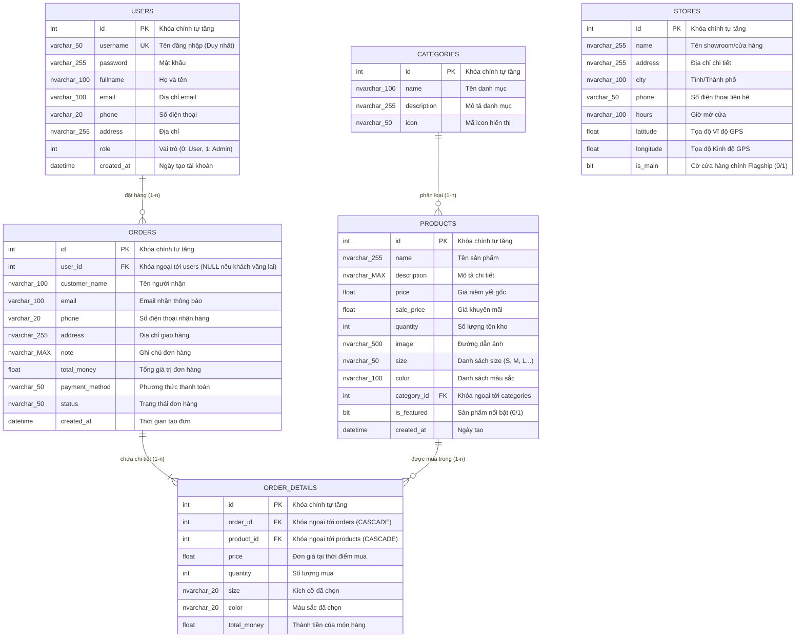

# TÀI LIỆU THIẾT KẾ CƠ SỞ DỮ LIỆU (DATABASE DESIGN DOCUMENT)
## HỆ THỐNG QUẢN LÝ BÁN HÀNG THỜI TRANG (BAN_HANG_DB)
**Hệ quản trị CSDL:** Microsoft SQL Server (T-SQL)  
**Tập ký tự (Collation):** Vietnamese_CI_AS / UTF-8  
**Tên Database:** `ban_hang_db`  

---

## 1. SƠ ĐỒ QUAN HỆ THỰC THỂ (ENTITY RELATIONSHIP DIAGRAM - ERD)

---

## 2. CHI TIẾT CẤU TRÚC CÁC BẢNG (DATA DICTIONARY)

### 2.1. Bảng `categories` (Danh mục sản phẩm)
Lưu trữ các nhóm danh mục phân loại thời trang (Áo Nam, Quần Nam, Thời Trang Nữ, Phụ Kiện).
| STT | Tên cột | Kiểu dữ liệu | Nullable | Khóa / Ràng buộc | Ý nghĩa / Diễn giải |
|:---:|:---|:---|:---:|:---|:---|
| 1 | `id` | `INT` | No | **PK**, IDENTITY(1,1) | Khóa chính tự tăng |
| 2 | `name` | `NVARCHAR(100)` | No | | Tên danh mục thời trang |
| 3 | `description` | `NVARCHAR(255)` | Yes | | Mô tả ngắn về danh mục |
| 4 | `icon` | `NVARCHAR(50)` | Yes | DEFAULT 'bi-tag' | Tên icon Bootstrap Icons |

### 2.2. Bảng `products` (Sản phẩm)
Lưu trữ thông tin chi tiết từng mặt hàng thời trang được bày bán trên hệ thống.
| STT | Tên cột | Kiểu dữ liệu | Nullable | Khóa / Ràng buộc | Ý nghĩa / Diễn giải |
|:---:|:---|:---|:---:|:---|:---|
| 1 | `id` | `INT` | No | **PK**, IDENTITY(1,1) | Khóa chính tự tăng |
| 2 | `name` | `NVARCHAR(255)` | No | | Tên sản phẩm |
| 3 | `description` | `NVARCHAR(MAX)` | Yes | | Mô tả chi tiết chất liệu, form dáng |
| 4 | `price` | `FLOAT` | No | | Giá niêm yết ban đầu (VNĐ) |
| 5 | `sale_price` | `FLOAT` | Yes | DEFAULT 0 | Giá khuyến mãi (0 nếu không sale) |
| 6 | `quantity` | `INT` | Yes | DEFAULT 100 | Số lượng sản phẩm còn trong kho |
| 7 | `image` | `NVARCHAR(500)` | Yes | | URL hình ảnh minh họa sản phẩm |
| 8 | `size` | `NVARCHAR(50)` | Yes | DEFAULT 'S, M, L, XL' | Các size hiện có (ngăn cách bởi dấu phẩy) |
| 9 | `color` | `NVARCHAR(100)` | Yes | DEFAULT 'Trắng, Đen...'| Các màu sắc hiện có |
| 10 | `category_id` | `INT` | No | **FK** categories(id) | Khóa ngoại tham chiếu danh mục |
| 11 | `is_featured` | `BIT` | Yes | DEFAULT 0 | Cờ sản phẩm bán chạy / nổi bật |
| 12 | `created_at` | `DATETIME` | Yes | DEFAULT GETDATE() | Ngày giờ thêm sản phẩm |

### 2.3. Bảng `users` (Người dùng)
Lưu trữ tài khoản của cả khách hàng thành viên lẫn ban quản trị.
| STT | Tên cột | Kiểu dữ liệu | Nullable | Khóa / Ràng buộc | Ý nghĩa / Diễn giải |
|:---:|:---|:---|:---:|:---|:---|
| 1 | `id` | `INT` | No | **PK**, IDENTITY(1,1) | Khóa chính tự tăng |
| 2 | `username` | `VARCHAR(50)` | No | **UNIQUE** | Tên đăng nhập tài khoản |
| 3 | `password` | `VARCHAR(255)` | No | | Mật khẩu tài khoản |
| 4 | `fullname` | `NVARCHAR(100)` | No | | Họ và tên người dùng |
| 5 | `email` | `VARCHAR(100)` | No | | Địa chỉ email liên hệ |
| 6 | `phone` | `VARCHAR(20)` | Yes | | Số điện thoại cá nhân |
| 7 | `address` | `NVARCHAR(255)` | Yes | | Địa chỉ giao hàng mặc định |
| 8 | `role` | `INT` | Yes | DEFAULT 0 | **0**: Khách hàng, **1**: Admin |
| 9 | `created_at` | `DATETIME` | Yes | DEFAULT GETDATE() | Ngày giờ khởi tạo tài khoản |

### 2.4. Bảng `orders` (Đơn hàng)
Lưu trữ thông tin tổng quát về các đơn hàng phát sinh trên website.
| STT | Tên cột | Kiểu dữ liệu | Nullable | Khóa / Ràng buộc | Ý nghĩa / Diễn giải |
|:---:|:---|:---|:---:|:---|:---|
| 1 | `id` | `INT` | No | **PK**, IDENTITY(1,1) | Mã đơn hàng (Khóa chính tự tăng) |
| 2 | `user_id` | `INT` | Yes | **FK** users(id) | Tham chiếu tài khoản (NULL nếu là khách vãng lai) |
| 3 | `customer_name`| `NVARCHAR(100)` | No | | Họ tên người nhận hàng |
| 4 | `email` | `VARCHAR(100)` | No | | Email người nhận |
| 5 | `phone` | `VARCHAR(20)` | No | | Số điện thoại người nhận hàng |
| 6 | `address` | `NVARCHAR(255)` | No | | Địa chỉ giao hàng tận nơi |
| 7 | `note` | `NVARCHAR(MAX)` | Yes | | Ghi chú thêm của khách khi đặt hàng |
| 8 | `total_money` | `FLOAT` | No | | Tổng tiền thanh toán của đơn hàng |
| 9 | `payment_method`| `NVARCHAR(50)` | Yes | DEFAULT 'COD' | Hình thức thanh toán |
| 10 | `status` | `NVARCHAR(50)` | Yes | DEFAULT 'PENDING' | Trạng thái (`PENDING`, `COMPLETED`, `CANCELLED`)|
| 11 | `created_at` | `DATETIME` | Yes | DEFAULT GETDATE() | Thời điểm đặt hàng |

### 2.5. Bảng `order_details` (Chi tiết đơn hàng)
Lưu trữ từng món hàng cụ thể thuộc về đơn hàng đó.
| STT | Tên cột | Kiểu dữ liệu | Nullable | Khóa / Ràng buộc | Ý nghĩa / Diễn giải |
|:---:|:---|:---|:---:|:---|:---|
| 1 | `id` | `INT` | No | **PK**, IDENTITY(1,1) | Khóa chính tự tăng |
| 2 | `order_id` | `INT` | No | **FK** orders(id) ON DELETE CASCADE | Thuộc đơn hàng nào |
| 3 | `product_id` | `INT` | No | **FK** products(id) ON DELETE CASCADE | Là sản phẩm nào |
| 4 | `price` | `FLOAT` | No | | Đơn giá tại thời điểm chốt đơn |
| 5 | `quantity` | `INT` | No | | Số lượng đặt mua |
| 6 | `size` | `NVARCHAR(20)` | Yes | | Size đã chọn khi đặt |
| 7 | `color` | `NVARCHAR(20)` | Yes | | Màu sắc đã chọn khi đặt |
| 8 | `total_money` | `FLOAT` | No | | Thành tiền (`price * quantity`) |

### 2.6. Bảng `stores` (Chuỗi cửa hàng & Bản đồ)
Lưu trữ danh sách các chi nhánh cửa hàng thực tế cùng tọa độ GPS.
| STT | Tên cột | Kiểu dữ liệu | Nullable | Khóa / Ràng buộc | Ý nghĩa / Diễn giải |
|:---:|:---|:---|:---:|:---|:---|
| 1 | `id` | `INT` | No | **PK**, IDENTITY(1,1) | Khóa chính tự tăng |
| 2 | `name` | `NVARCHAR(255)` | No | | Tên showroom cửa hàng |
| 3 | `address` | `NVARCHAR(255)` | No | | Địa chỉ đường/phường/quận |
| 4 | `city` | `NVARCHAR(100)` | No | | Thành phố (Hà Nội, TP.HCM, Đà Nẵng) |
| 5 | `phone` | `VARCHAR(50)` | Yes | | Hotline chi nhánh |
| 6 | `hours` | `NVARCHAR(100)` | Yes | DEFAULT '08:30 - 22:00'| Khung giờ mở cửa phục vụ |
| 7 | `latitude` | `FLOAT` | No | | Vĩ độ địa lý (GPS Latitude) |
| 8 | `longitude` | `FLOAT` | No | | Kinh độ địa lý (GPS Longitude) |
| 9 | `is_main` | `BIT` | Yes | DEFAULT 0 | Cờ đánh dấu cơ sở Flagship chính |

---

## 3. RÀNG BUỘC TOÀN VẸN & CHÍNH SÁCH CASCADE (INTEGRITY CONSTRAINTS)

1. **Ràng buộc khóa ngoại `products.category_id` -> `categories.id`:**
   - Hành vi: `ON DELETE CASCADE`. Khi một danh mục bị xóa, tất cả sản phẩm thuộc danh mục đó cũng tự động bị xóa đồng bộ.
2. **Ràng buộc khóa ngoại `orders.user_id` -> `users.id`:**
   - Hành vi: `ON DELETE SET NULL`. Khi tài khoản người dùng bị xóa, đơn hàng đã phát sinh vẫn được lưu trữ trong hệ thống và trường `user_id` được chuyển thành `NULL` nhằm bảo toàn số liệu kế toán.
3. **Ràng buộc khóa ngoại `order_details.order_id` -> `orders.id`:**
   - Hành vi: `ON DELETE CASCADE`. Khi xóa đơn hàng, toàn bộ chi tiết sản phẩm của đơn hàng đó sẽ bị xóa theo.
