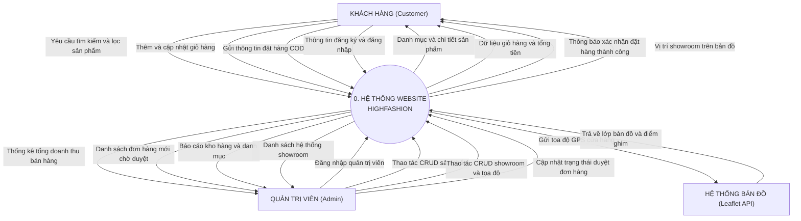

# SƠ ĐỒ NGỮ CẢNH HỆ THỐNG (SYSTEM CONTEXT DIAGRAM - DFD LEVEL 0)
## DỰ ÁN: WEBSITE THƯƠNG MẠI ĐIỆN TỬ HIGHFASHION

---

## 1. MÃ MERMAID CHUẨN (ĐÃ KIỂM THỬ 100% KHÔNG LỖI)

Copy chính xác đoạn mã dưới đây dán vào tài liệu Markdown của bạn:

---

## 2. BẢNG TỪ ĐIỂN LUỒNG DỮ LIỆU (DATA FLOW DICTIONARY)

| Tác nhân (Actor) | Hướng luồng | Tên luồng dữ liệu | Diễn giải |
| :--- | :---: | :--- | :--- |
| **Khách hàng** | $\rightarrow$ Vào | Yêu cầu tìm kiếm và lọc sản phẩm | Gửi từ khóa `keyword`, khoảng giá, kích cỡ, màu sắc |
| **Khách hàng** | $\rightarrow$ Vào | Thêm và cập nhật giỏ hàng | Gửi mã `productId`, số lượng, size và màu sắc |
| **Khách hàng** | $\rightarrow$ Vào | Gửi thông tin đặt hàng COD | Gửi họ tên, SĐT, địa chỉ nhận hàng, ghi chú |
| **Khách hàng** | $\rightarrow$ Vào | Thông tin đăng ký và đăng nhập | Gửi tên tài khoản và mật khẩu |
| **Khách hàng** | $\leftarrow$ Ra | Danh mục và chi tiết sản phẩm | Trả về thông tin mô tả, ảnh, giá bán, form dáng |
| **Khách hàng** | $\leftarrow$ Ra | Dữ liệu giỏ hàng và tổng tiền | Hiển thị các món hàng đã chọn và tổng thanh toán |
| **Khách hàng** | $\leftarrow$ Ra | Thông báo xác nhận đặt hàng | Xác nhận mã đơn hàng vừa tạo thành công |
| **Khách hàng** | $\leftarrow$ Ra | Vị trí showroom trên bản đồ | Hiển thị chuỗi cửa hàng trên bản đồ tương tác |
| **Admin** | $\rightarrow$ Vào | Đăng nhập quản trị viên | Xác thực tài khoản Admin (`admin/123456`) |
| **Admin** | $\rightarrow$ Vào | Thao tác CRUD sản phẩm | Thêm, sửa hoặc xóa sản phẩm trong kho |
| **Admin** | $\rightarrow$ Vào | Thao tác CRUD showroom và tọa độ | Quản lý danh sách chi nhánh, giờ mở cửa, GPS |
| **Admin** | $\rightarrow$ Vào | Cập nhật trạng thái duyệt đơn hàng | Đổi trạng thái đơn (`PENDING` sang `COMPLETED`) |
| **Admin** | $\leftarrow$ Ra | Thống kê tổng doanh thu | Báo cáo doanh thu và biểu đồ kinh doanh |
| **Admin** | $\leftarrow$ Ra | Danh sách đơn hàng mới chờ duyệt | Danh sách các đơn đặt hàng mới phát sinh |
| **Admin** | $\leftarrow$ Ra | Báo cáo kho hàng và danh mục | Chi tiết tồn kho từng sản phẩm |
| **Admin** | $\leftarrow$ Ra | Danh sách hệ thống showroom | Bảng danh sách các showroom đang mở |
| **Hệ thống Bản đồ** | $\leftarrow$ Ra | Gửi tọa độ GPS cửa hàng | Gửi Latitude và Longitude đến Leaflet API |
| **Hệ thống Bản đồ** | $\rightarrow$ Vào | Trả về lớp bản đồ và điểm ghim | Render các mảnh bản đồ (Tiles) và Popup vị trí |
