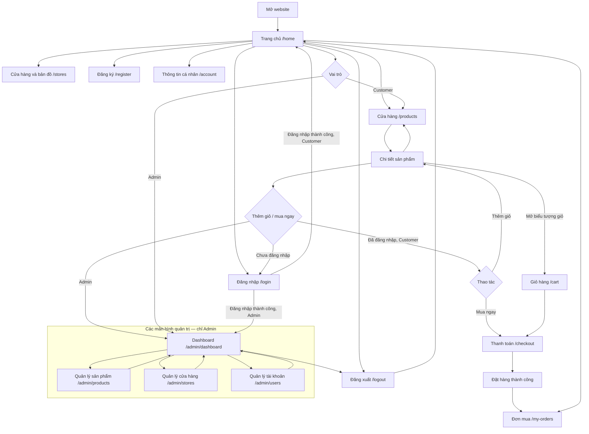
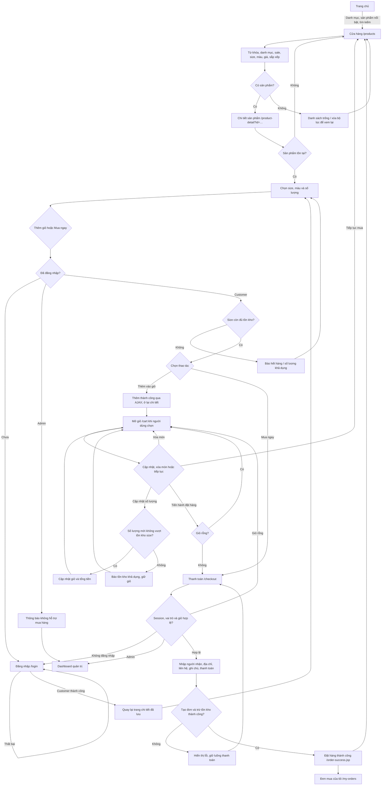
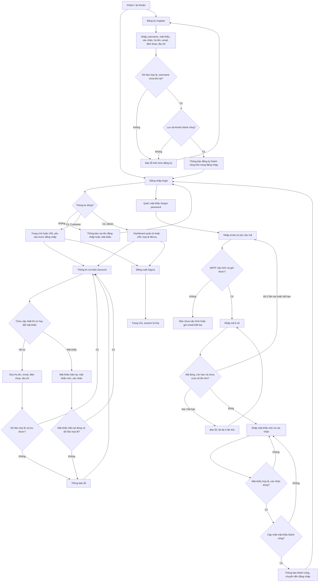
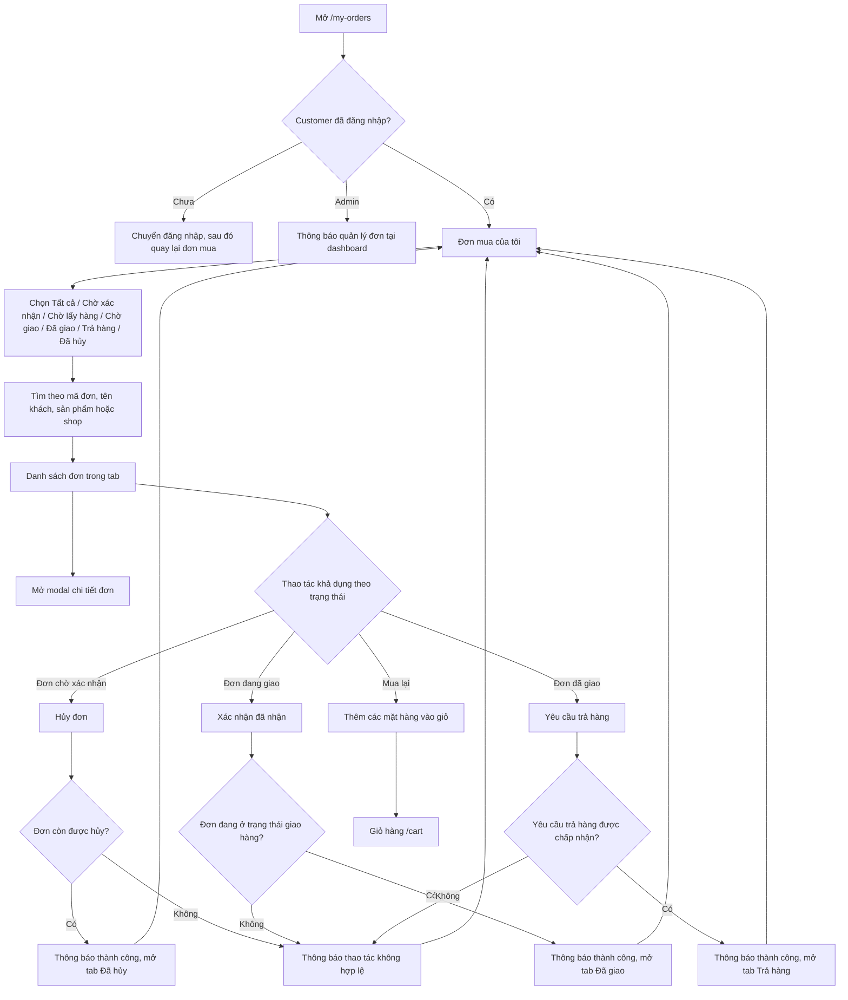
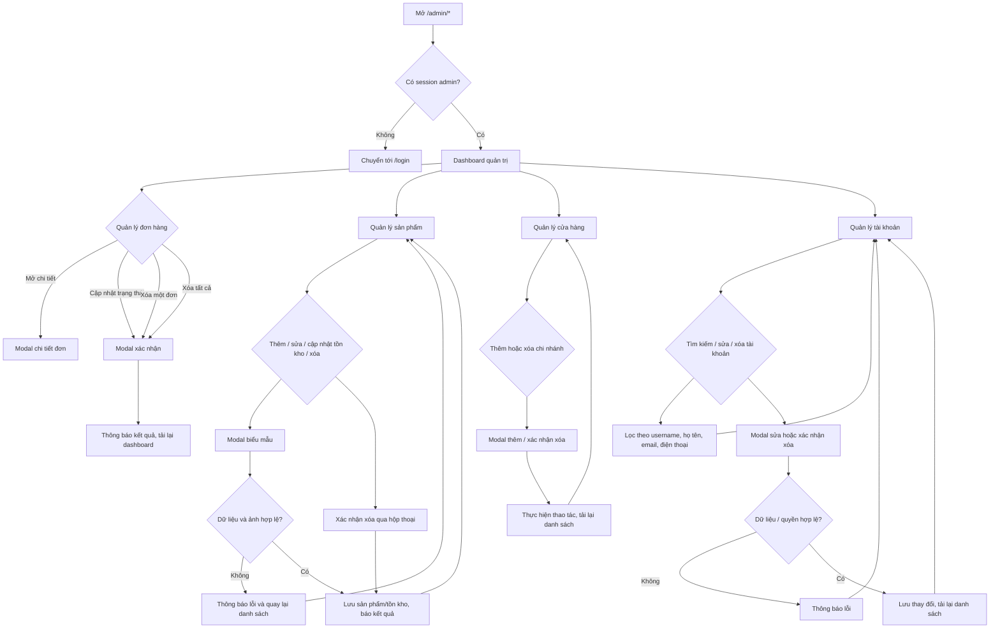

# Tài liệu Screen Flow — HighFashion

| Thuộc tính | Giá trị |
|---|---|
| Dự án | Website thương mại điện tử thời trang HighFashion |
| Phiên bản tài liệu | 1.0 |
| Ngày lập | 20/11/2026 |
| Phạm vi | Các màn hình, điều hướng, nhánh thành công, lỗi và phân quyền đang được triển khai |

## 1. Mục đích và quy ước

Tài liệu mô tả cách người dùng đi qua các màn hình của website theo luồng thực tế trong mã nguồn. Đây là đặc tả luồng màn hình hiện tại, không phải danh sách tính năng dự kiến.

- `{GET}`: mở màn hình hoặc đọc dữ liệu.
- `{POST}`: gửi biểu mẫu hoặc thực hiện thay đổi dữ liệu.
- `Forward`: máy chủ hiển thị JSP trong cùng request.
- `Redirect`: trình duyệt chuyển sang URL khác.
- `Modal`: hộp thoại nằm trong màn hình hiện tại, không phải route riêng.
- `Guest`: khách chưa đăng nhập; `Customer`: khách hàng; `Admin`: quản trị viên.
- Mọi URL bên dưới đều nằm dưới context path của ứng dụng, ví dụ `/ban_hang`.

## 2. Bản đồ màn hình và route

| Màn hình | Route / JSP | Quyền và cách vào |
|---|---|---|
| Trang chủ | `GET /home` → `index.jsp` | Công khai; route gốc cũng được ánh xạ tới trang chủ |
| Cửa hàng / danh sách sản phẩm | `GET /products` → `shop.jsp` | Công khai; tìm kiếm, lọc và sắp xếp qua query string |
| Chi tiết sản phẩm | `GET /product-detail?id=…` → `detail.jsp` | Công khai; `/detail` là alias cũ |
| Cửa hàng và bản đồ | `GET /stores` → `stores.jsp` | Công khai |
| Đăng nhập | `GET, POST /login` → `login.jsp` | Công khai |
| Đăng ký | `GET, POST /register` → `register.jsp` | Công khai |
| Quên mật khẩu | `GET, POST /forgot-password` → `forgot-password.jsp` | Công khai |
| Giỏ hàng | `GET, POST /cart` → `cart.jsp` | Chỉ khách hàng đã đăng nhập; admin bị chuyển về dashboard |
| Thanh toán | `GET, POST /checkout` → `checkout.jsp` | Chỉ khách hàng đã đăng nhập và giỏ không rỗng |
| Đặt hàng thành công | POST `/checkout` → `order-success.jsp` | Chỉ xuất hiện sau khi tạo đơn thành công |
| Đơn mua của tôi | `GET, POST /my-orders` → `my-orders.jsp` | Chỉ khách hàng; `/user/orders` là alias |
| Thông tin cá nhân | `GET, POST /account` → `account.jsp` | Mọi tài khoản đã đăng nhập |
| Dashboard quản trị | `GET /admin/dashboard` → `admin-dashboard.jsp` | Chỉ admin |
| Quản lý sản phẩm | `GET, POST /admin/products` → `admin-products.jsp` | Chỉ admin |
| Quản lý cửa hàng | `GET, POST /admin/stores` → `admin-stores.jsp` | Chỉ admin |
| Quản lý tài khoản | `GET, POST /admin/users` → `admin-users.jsp` | Chỉ admin |
| Đăng xuất | `GET, POST /logout` | Hủy session, sau đó về trang chủ |

Các JSP là màn hình trình bày; luồng bình thường truy cập qua route Servlet tương ứng. Những biểu mẫu quản trị dùng modal nhưng vẫn thuộc màn hình quản trị hiện tại.

## 3. Luồng điều hướng tổng quan

### Điều hướng theo phiên và vai trò

1. Người chưa đăng nhập có thể xem trang chủ, danh sách/chi tiết sản phẩm và cửa hàng.
2. Khi khách chưa đăng nhập truy cập giỏ hàng, thanh toán hoặc đơn mua, website lưu đích cần quay lại trong session và yêu cầu đăng nhập. Sau đăng nhập, khách được chuyển về đích đó.
3. Nếu admin đi vào giỏ hàng, thanh toán hoặc đơn mua cá nhân, ứng dụng đưa về dashboard quản trị thay vì cho thực hiện mua hàng.
4. Các route `/admin/*` kiểm tra session và quyền admin ở phía máy chủ. Người không đủ quyền được chuyển đến trang đăng nhập.
5. Đăng xuất hủy toàn bộ session hiện tại, bao gồm giỏ hàng gắn với session.

## 4. Luồng khám phá và mua hàng

### Hành vi các màn hình mua sắm

- **Trang chủ:** mở sản phẩm nổi bật/mới, danh mục, liên kết cửa hàng, bản đồ và giỏ.
- **Danh sách:** nhận các tham số `keyword`, `categoryId`, `filter`, `sort`, `size`, `color`, `priceRange`. Kết quả có thể rỗng; người dùng có thể xóa bộ lọc để quay về danh sách.
- **Chi tiết:** ID sản phẩm không hợp lệ hoặc không tồn tại sẽ chuyển về `/products`. Người mua chọn biến thể size/màu và số lượng; thiếu tồn kho thì nhận thông báo và ở lại trang chi tiết.
- **Giỏ:** mặt hàng được phân biệt theo sản phẩm, size và màu; số lượng bị giới hạn bởi tồn kho theo size. Có thể cập nhật hoặc xóa mặt hàng trước khi thanh toán.
- **Thanh toán:** kiểm tra đăng nhập, vai trò và giỏ không rỗng. Tạo đơn thành công mới xóa giỏ; lỗi tạo đơn được báo và người dùng quay lại luồng thanh toán.
- Tồn kho được kiểm tra khi thêm/cập nhật giỏ và khi tạo đơn; đơn đã tạo giữ thông tin các mặt hàng cùng size/màu đã chọn.

## 5. Luồng tài khoản và xác thực

### Quy tắc quên mật khẩu

- Email chưa đăng ký không được tiết lộ rõ ràng; giao diện dùng thông báo chung.
- Mã xác nhận có 6 chữ số, hiệu lực 10 phút; tối đa 5 lần nhập sai.
- Sau khi xác minh, thời gian đặt mật khẩu mới là 5 phút; yêu cầu gửi lại mã có thời gian chờ 60 giây.
- Cần cấu hình `GMAIL_SMTP_USERNAME` và `GMAIL_SMTP_APP_PASSWORD` cho tiến trình Tomcat để gửi thư.

## 6. Luồng đơn mua của khách hàng

Tab trạng thái được lọc theo nhóm trạng thái tương ứng: chờ xác nhận, chờ lấy hàng, chờ giao, đã giao, trả hàng/hoàn tiền và đã hủy. Các thao tác cập nhật trả về trang đơn mua kèm thông báo kết quả.

## 7. Luồng quản trị

### Chi tiết các phân hệ quản trị

#### Dashboard và xử lý đơn

- Dashboard tổng hợp số sản phẩm, số đơn, đơn chờ xác nhận và doanh thu; hiển thị bảng đơn gần đây.
- Trạng thái đơn quyết định các thao tác gợi ý: chờ xác nhận → xác nhận hoặc hủy; chờ lấy hàng → chuyển giao hoặc hủy; đang giao → xác nhận đã giao hoặc trả hàng; các trạng thái khác có thể khôi phục về chờ xác nhận theo giao diện.
- Xóa đơn hoặc xóa tất cả yêu cầu xác nhận trước khi thực hiện.
- Mọi thao tác trả thông báo thành công/lỗi và tải lại dashboard.

#### Sản phẩm và tồn kho

- Thêm/sửa sản phẩm trong modal; nhập thông tin, danh mục, size và số lượng tồn kho theo từng size.
- Có thể cập nhật tồn kho theo size từ modal sửa; xóa sản phẩm có hộp thoại xác nhận.
- Ảnh tải lên giới hạn 5 MB; chỉ nhận JPEG, PNG, GIF hoặc WebP đúng định dạng.
- Lỗi nhập liệu, ảnh hoặc lưu dữ liệu hiển thị thành thông báo trên trang quản lý.

#### Cửa hàng

- Danh sách cửa hàng có thao tác thêm và xóa theo giao diện hiện tại.
- Khi thêm, nhập tên, địa chỉ, thành phố, điện thoại, giờ mở cửa, tọa độ và trạng thái cửa hàng chính.
- Mã controller hiện có `add` và `delete`; tài liệu không mô tả chức năng sửa chi nhánh vì chưa thấy luồng cập nhật trong implementation hiện tại.

#### Tài khoản

- Tìm kiếm theo tên đăng nhập, họ tên, email và số điện thoại.
- Có thể sửa thông tin, quyền và tùy chọn đặt mật khẩu mới; có thể xóa tài khoản khác.
- Không thể tự xóa tài khoản đang đăng nhập hoặc tự hạ quyền quản trị; không thể xóa/hạ quyền admin cuối cùng.

## 8. Các luồng phụ và kết quả thay thế

| Tình huống | Kết quả màn hình / điều hướng |
|---|---|
| URL chi tiết không có sản phẩm tương ứng | Chuyển về `/products` |
| Thêm/cập nhật số lượng vượt tồn kho theo size | Báo số lượng còn khả dụng; giữ người dùng ở chi tiết hoặc giỏ |
| Gửi cart bằng AJAX nhưng chưa đăng nhập | Trả trạng thái yêu cầu đăng nhập cùng URL điều hướng |
| Admin truy cập giỏ, thanh toán hoặc đơn cá nhân | Thông báo và chuyển về dashboard |
| Giỏ rỗng khi vào thanh toán | Chuyển về `/cart` |
| Đăng ký sai dữ liệu, trùng tên đăng nhập hoặc lưu lỗi | Giữ form đăng ký và hiển thị lỗi |
| Đăng nhập sai | Giữ form đăng nhập và thông báo lỗi |
| Quên mật khẩu: SMTP chưa cấu hình/gửi lỗi | Giữ màn hình quên mật khẩu và hiển thị lỗi |
| Mã sai, hết hạn hoặc hết lượt | Cho thử lại trong giới hạn; hết lượt/hết hạn thì yêu cầu mã mới |
| Truy cập route quản trị không có quyền | Chuyển về `/login` |
| Lỗi CRUD quản trị | Thông báo toast và tải lại màn hình quản lý tương ứng |
| Đăng xuất | Hủy session, chuyển `/home` |

## 9. Phạm vi và lưu ý triển khai

- Trang cửa hàng hiện chọn chi nhánh chính để hiển thị; bản đồ và danh sách dùng dữ liệu chi nhánh do controller cung cấp.
- Hình thức thanh toán được ghi trong đơn theo dữ liệu form; controller dùng COD nếu không nhận được phương thức thanh toán. Không có luồng cổng thanh toán bên ngoài trong các route được rà soát.
- Tạo đơn thất bại không đi tới màn hình thành công; thông báo lỗi được hiển thị trong luồng checkout.
- Modal xác nhận là thành phần của trang, không phải màn hình/route riêng.
- Bảng trên mô tả luồng khách quan sát được. Các chi tiết dữ liệu, quy tắc nghiệp vụ và kiểm thử đầy đủ nằm trong [SRS](./01_SRS_Dac_Ta_Yeu_Cau_Phan_Mem.md), [Thiết kế kiến trúc](./02_Thiet_Ke_Kien_Truc_He_Thong.md) và [Test Cases](./04_Kich_Ban_Kiem_Thu_Test_Cases.md).
